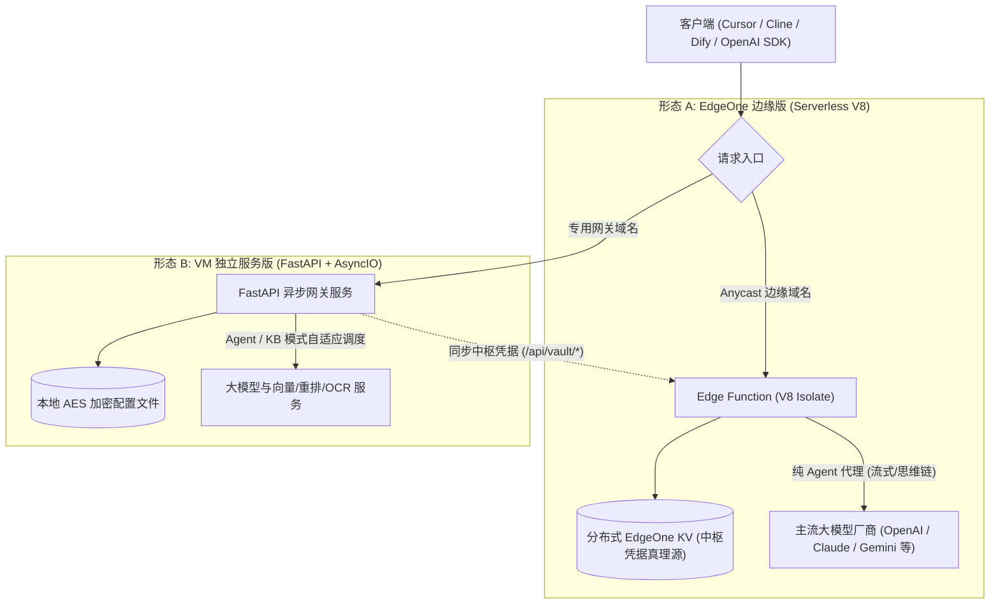
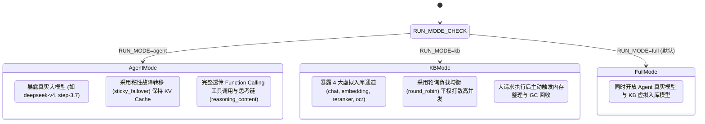
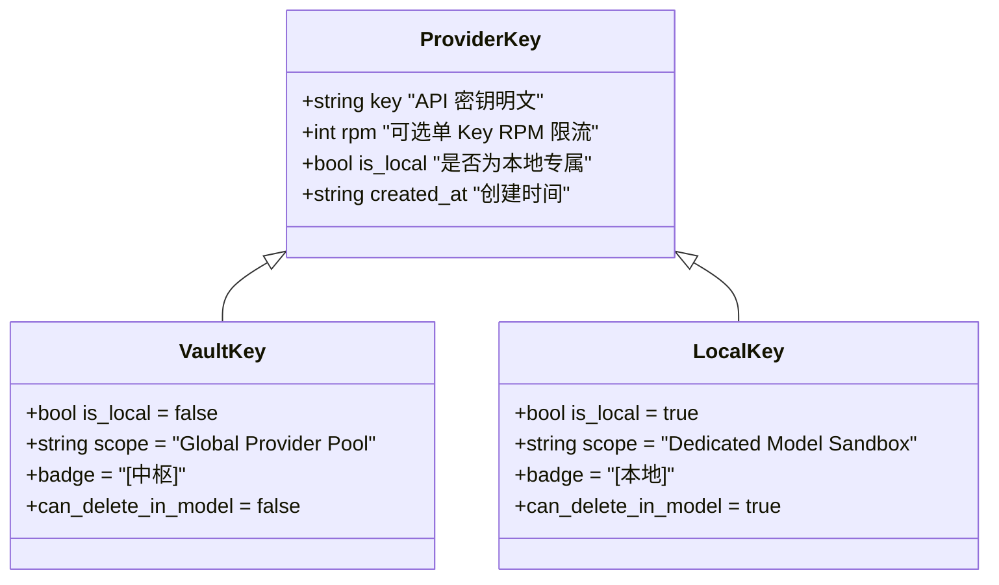
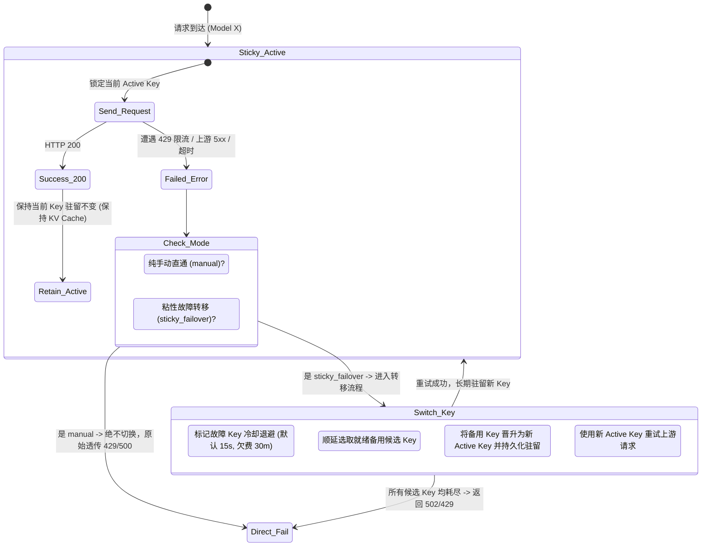
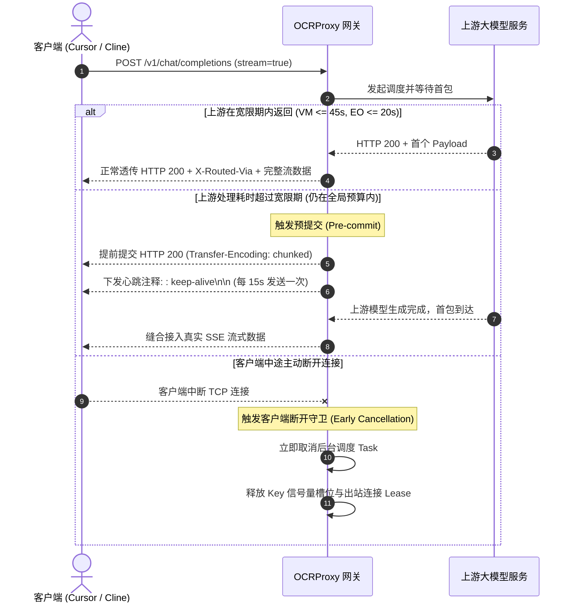
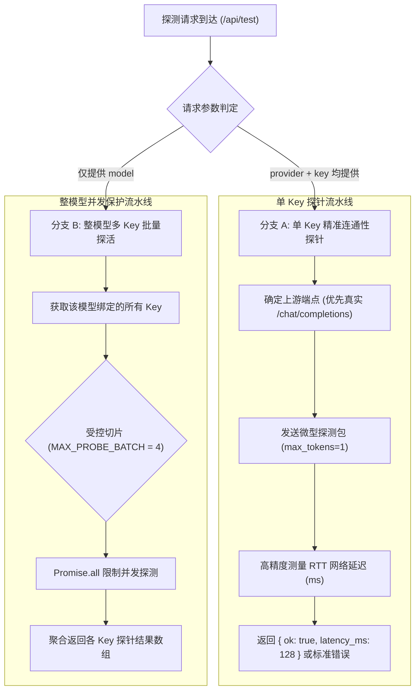

# OCRProxy 系统核心设计与业务架构规格书 (System Design Specification)

> **版本**：v2026.10.18  
> **状态**：正式生效（系统统一真理源设计蓝图）  
> **适用范围**：全平台（EdgeOne 边缘无服务器版、VM 独立服务版、管理控制台前端、调度器与路由引擎）  
> **原则**：本文档为 OCRProxy 纯粹的软件工程设计规格，严禁掺杂任何具体私有主机 IP、云服务商个人实例或生产密钥（私有部署运维配置统一归档于本地私有文件 `LOCAL_ENV_SECRETS.md`）。

---

## 目录 (Table of Contents)
1. [系统定位与两大产品形态 (Software Flavors)](#1-系统定位与两大产品形态-software-flavors)
   - 1.1 [形态对比与技术规格](#11-形态对比与技术规格)
   - 1.2 [核心解耦架构：配置与主程序分离原则 (零发版迭代)](#12-核心解耦架构配置与主程序分离原则-零发版迭代)
   - 1.3 [厂商适配预设演进规范：日期驱动与按需差量同步](#13-厂商适配预设演进规范日期驱动与按需差量同步-date-driven--on-demand-differential-sync)
2. [软件运行模式规格 (Runtime Modes)](#2-软件运行模式规格-runtime-modes)
3. [核心凭据架构与生命周期 (Vault Hub vs Local Key)](#3-核心凭据架构与生命周期-vault-hub-vs-local-key)
   - 3.4 [中枢与本地二元权限矩阵与可变性规则](#34-中枢与本地二元权限矩阵与可变性规则-vault-vs-local-matrix)
4. [路由调度算法与频控状态机 (Scheduler & Rate Limiting)](#4-路由调度算法与频控状态机-scheduler--rate-limiting)
5. [探针机制与网络探测规格 (Health Probing)](#5-探针机制与网络探测规格-health-probing)
6. [前端 UI 架构与双端契约 (UI Parity & Component Contract)](#6-前端-ui-架构与双端契约-ui-parity--component-contract)
7. [统一数据 Schema v2 规范 (Data Schema)](#7-统一数据-schema-v2-规范-data-schema)
8. [变更与文档强制联动治理 (Document-First Governance)](#8-变更与文档强制联动治理-document-first-governance)

---

## 1. 系统定位与两大产品形态 (Software Flavors)

OCRProxy 是一套专为大模型、多模态图文识别与知识库场景设计的高性能、高可用反向代理与多 Key 弹性调度网关。系统采用单一代码仓库（Monorepo）维护，提供两大物理独立但数据与协议 100% 互通的产品形态：



### 1.1 形态对比与技术规格

| 维度 | EdgeOne 边缘 Serverless 版 (`agent-edgeone/`) | VM 独立自建版 (`vm-app/`) |
| :--- | :--- | :--- |
| **运行宿主** | 腾讯云 EdgeOne 边缘函数 (V8 Isolate 引擎) | Linux / Unix 物理机、虚拟机或容器 (Python 3.10+) |
| **启动特性** | **零冷启动**，全球 Anycast 就近接入，无常驻进程 | 常驻 Daemon 进程 (Systemd / Docker)，支持本地硬件调用 |
| **存储介质** | 分布式 EdgeOne KV (Key-Value 存储) | 本地持久化加密文件 (`proxy_config.enc`，AES-Fernet) |
| **核心定位** | **【云端凭据金库中枢 (Vault Hub)】** + 纯 Agent 高可用网关 | **【生产算力执行工作节点 (Worker)】** + 知识库高并发调度器 |
| **超时预算** | 硬性最大预算 **300 秒** (避免长连接挂死) | 可自主配置超时 (默认 30~120 秒，支持长轮询) |
| **协议支持** | OpenAI Chat、Anthropic Messages、Google Gemini 原生 | OpenAI Chat、Claude、Gemini、Embedding、Reranker、OCR |

### 1.2 核心解耦架构：配置与主程序分离原则 (零发版迭代)

为避免频繁发版造成版本号通胀与生产系统运维疲劳，OCRProxy 严格执行**「配置与主程序物理分离」**的设计原则：

1. **厂商适配与主程序引擎解耦**：
   - 厂商适配规则（请求头改写、模型参数映射、思考链提取策略等）全部收敛在 `shared/presets/*.json` 声明式数据文件中；
   - 引擎代码（`scheduler.py`、`proxy_routes.py`、`completions.js`）为通用调度器，不硬编码特定厂商专有业务逻辑；
   - **日常增加厂商预设、调整厂商 Base URL、微调模型字段映射，直接提交预设文件或热加载，绝不触发系统发版（不递增 `version.json`）**。
2. **说明文档与主程序生命周期解耦**：
   - `README.md`、`docs/` 技术文档、注释及排版调整，属于纯文档演进，**严禁触发系统发版**；
3. **系统发版准入边界 (SemVer 铁律)**：
   - 🔴 **必须发版（升级 `version.json` 并走全流水线门禁）**：核心调度算法重构（如流式首包心跳、连接池保护）、网络协议底层改造、系统配置 Schema 字段变更、关键安全防线加固；
   - 🟢 **严禁发版（零发版热更新/常规提交）**：厂商 presets 预设增删改、说明文档与操作手册维护、测试用例扩充。

### 1.3 厂商适配预设演进规范：日期驱动与按需差量同步 (Date-Driven & On-Demand Differential Sync)

为杜绝厂商规则更新黑盒与全局配置污染，系统确立了预设规范的两大物理铁律：

1. **日期与说明标准化 (Date-Driven Specification)**：
   - 所有官方厂商预设文件（`shared/presets/*.json`）及轻量目录索引（`catalog.json`）必须包含且严格校验两项元数据：
     - `updated_at`：标准 ISO 日期格式 (`YYYY-MM-DD`)，准确记录规则最后修订日期；
     - `update_notes`：清晰的中文更新说明，说明该版本针对上游平台的改动（例如协议兼容、模型列表增补、思考参数优化等）；
   - 前端管理后台在下拉单选与模板卡片上直观渲染版本与更新日期胶囊 (`📅 更新日期: YYYY-MM-DD`)，杜绝信息黑盒。
2. **零全量污染与物理级按需拉取 (Physical-Level On-Demand Pulling)**：
   - **新增添加时（按需单条拉取）**：用户在管理后台选择某一厂商预设时，前端仅单条请求 `/api/admin/presets/detail?id=<id>`，仅下载所选厂商的适配规则，**绝对禁止全量下载所有厂商预设**；
   - **更新拉取时（差量/仅已存更新）**：
     - 后端（EdgeOne 边缘函数 `updateConfiguredRules` 与 VM `update_preset_rules_endpoint`）对传入的 `provider_ids` 实施强制物理过滤：`valid_target_ids = [pid for pid in target_ids if pid in providers]`；
     - **严禁全量拉取**：本地存了哪些厂商就只更新哪些厂商的适配规则，任何未在本地配置中存在的厂商坚决不拉取、不写入本地配置，彻底杜绝云端模板对本地配置的侵入与污染。

---

## 2. 软件运行模式规格 (Runtime Modes)

VM 独立服务版通过环境变量 `RUN_MODE` 支持三大运行模式，一套核心代码自适应，无需分叉构建；EdgeOne 版本恒定专注运行于 Agent 模式。

### 2.1 三大运行模式定义



1. **`RUN_MODE=agent` (智能体编程直连模式)**：
   - **目标受众**：面向 Cursor、Cline、OpenClaw、Dify Agent 等 AI 编程助手与自主智能体；
   - **对外暴露模型**：后台配置的真实模型别名（如 `deepseek-v4-flash`、`gemini-2.5-flash`）；
   - **核心特性**：100% 保持流式首包时间（TTFT < 800ms）、无损透传 `tools` 与 `tool_calls` 工具闭环，严禁剥离 `reasoning_content` 思维链；
   - **默认调度策略**：`sticky_failover`（粘性故障转移）。
2. **`RUN_MODE=kb` (知识库高频入库模式)**：
   - **目标受众**：面向 Dify、FastGPT、RagFlow 等 RAG 知识库平台的批量文档解析、向量切片与重排检索；
   - **对外暴露模型**：严格收敛为 4 大聚合虚拟模型：
     - `chat`：文本切片总结、知识问答、上下文重写；
     - `embedding`：高并发文本向量化；
     - `reranker`：候选文档相似度重排序；
     - `ocr`：多模态图文识别与扫描件解析；
   - **默认调度策略**：`round_robin`（轮询负载均衡），原子化分摊并发压力。
3. **`RUN_MODE=full` (全功能混合双轨模式)**：
   - 兼顾开发者的个人编程 Agent 调用与本地知识库的入库需求，管理后台展示全量控制面板。

---

## 3. 核心凭据架构与生命周期 (Vault Hub vs Local Key)

OCRProxy 实行严格的**“中枢凭据 (Vault) 与本地凭据 (Local)”二元分权架构**。彻底杜绝凭据越权泄漏，确保云端真理源与本地临时调试互不污染。

### 3.1 凭据类型定义与属性对比



| 维度 | 中枢凭据 (Vault Key) | 本地专属凭据 (Local Key) |
| :--- | :--- | :--- |
| **创建与录入源头** | 统一在管理后台**【模型提供商 (Providers)】**页面添加 | 在**【模型列表 ➔ 添加/编辑模型】**弹窗中点击「+ 添加本地 Key」临时录入 |
| **数据归属** | 归属于 Provider 顶级凭据池 (`providers[name].keys`) | 仅挂载于特定模型实例 (`is_local: true`) |
| **UI 视觉徽章** | 灰色沉稳徽章：**`[中枢]`** | 绿色醒目徽章：**`[本地]`** |
| **删除操作权限** | **严禁在模型弹窗中删除**（`deleteBtn = ''`，不可被单删） | **允许在模型弹窗中点击 `×` 删除**（仅影响当前模型） |
| **跨端同步传播** | 允许通过 `/api/vault/manifest` 与 `/api/vault/fetch` 下发至各 Worker 节点 | **严格沙箱隔离，API 接口强行过滤，绝不下发/不回传云端** |
| **本地覆写保护** | 随中枢同步自动更新（权威覆盖） | **最高优先级保护**，同步中枢时即使同名也绝不覆盖本地 Key |

### 3.2 凭据归属判定算法与真理源契约 (`resolveKeySource`)

为杜绝「供应商列表」、「新增模型弹窗」以及「模型 Key 列表行」三处对凭据类型的判定出现分歧与飘移，前端统一通过 `resolveKeySource(provId, keyLabel)` 导出唯一真理源：
```javascript
function resolveKeySource(provId, keyLabel) {
  if (keyLabel === 'public' || keyLabel === '__public__') return 'public';
  const provs = (getCtx().cfg || {}).providers || {};
  const localProv = provs[provId] || Object.entries(provs).find(([k]) => k.toLowerCase() === String(provId || '').toLowerCase())?.[1];
  const raw = localProv && localProv.keys ? localProv.keys[keyLabel] : undefined;
  
  // 1. 显式标记 is_local: true 恒定为本地凭据
  if (raw && typeof raw === 'object' && raw.is_local === true) return 'local';
  
  // 2. EdgeOne 控制台自身即为金库中枢 (Hub)，未标记 is_local 的全量为中枢资产
  const isEdgeOne = Boolean(typeof HOST !== 'undefined' && HOST && HOST.isEdgeOne);
  if (isEdgeOne) return 'vault';
  
  // 3. VM 端：仅当中枢清单包含该 Key 或 Provider 标记为中枢同步时为 vault，其余自建一律为 local
  const remote = (typeof findVaultProvider === 'function') ? findVaultProvider(provId) : null;
  const remoteKeys = remote ? (remote.keys || []).map(k => typeof k === 'string' ? k : (k && (k.label || k.id)) || '').filter(Boolean) : [];
  if (remoteKeys.includes(keyLabel)) return 'vault';
  if (localProv && localProv.origin === 'vault') return 'vault';
  if (!localProv && remote) return 'vault';
  return 'local';
}
```

### 3.3 凭据同步与拉取协议契约

EdgeOne 作为 **Vault Hub (金库中枢)** 时，对外暴露 3 大安全资产接口：
1. `GET /api/vault/manifest`：
   - 鉴权头：`Authorization: Bearer <VAULT_ACCESS_TOKEN>`；
   - 响应内容：仅返回已配置供应商元数据列表（`name`、`protocol`、`base_url`、`has_keys`、`rpm_per_key`），**绝不包含任何明文 Key**，且自动剔除带有 `is_local: true` 的本地私有配置。
2. `POST /api/vault/fetch`：
   - 请求体：`{"provider": "stepfun", "key_label": "生产主号"}`；
   - 鉴权头：`Authorization: Bearer <VAULT_ACCESS_TOKEN>`；
   - 响应内容：返回该 Provider 的精准鉴权配置与明文 Key，供 VM 节点按需懒加载；拦截所有 `is_local: true` 请求（返回 404）。
3. `POST /api/vault/credentials`：
   - 专用无规则扁平凭据端点，严格剥离 `adapter_rules`，仅传输纯净 Base URL 与密钥。

### 3.4 供应商与 Key 管理全版本统一规约与权限矩阵 (Vault vs Local Matrix SSOT)

为确保 EdgeOne 与 VM 能够 **100% 共享复用前端组件 (`agent-models-ui.js` 与 `providers.js`)**，并终结概念混乱，全系统确立唯一真理源（SSOT）铁律：

```
                              ┌──────────────────────────────────────────────┐
                              │     唯一业务入口：【供应商 (Providers)】菜单    │
                              └──────────────────────┬───────────────────────┘
                                                     │
                    ┌────────────────────────────────┴───────────────────────────────┐
                    ▼                                                                ▼
         【EdgeOne 边缘版 (中枢母本)】                                     【VM 独立版 (本地自治)】
                    │                                                                │
          ┌─────────┴─────────┐                                            ┌─────────┴─────────┐
          ▼                   ▼                                            ▼                   ▼
    【中枢提供商】        【中枢 Key】                               【从属于本地的提供商】     【本地 Key 凭据】
    - 添加即中枢母本     - 增删改查全权写入                           - 按需拉取，拉下即本地    - [中枢] Key: 只读可删
    - 删除即彻底消失     - 彻底废弃临时Key                            - 允许随时全权物理删除    - [本地] Key: 自由增删改
                                                                   - 删了重拉实现无损同步
```

#### 1. 核心规约与生命周期定义

1. **供应商管理规约**：
   - **唯一入口**：所有版本（EdgeOne 与 VM）添加模型提供商的**唯一入口必须是「供应商」标签页**。严禁在「添加模型 / 模型管理」弹窗中隐式拉取或添加供应商。模型弹窗下拉框仅展示本地已配置的提供商。
   - **EdgeOne 中枢母本**：在 EdgeOne「供应商」菜单中添加的提供商即中枢母本资产；删除则彻底从中枢数据库/KV 中清除。
   - **VM 本地化与自由删除**：VM 端从中枢按需拉取的提供商归属本地资产，**完全允许删除**。点击删除即清除本地该供应商及其名下 Key 和关联模型绑定。
   - **VM 按需拉取与稳健同步**：
     - VM 端在「+ 新增供应商」弹窗中，通过预设下拉框选择中枢未导入项，按需拉取到本地；
     - GitHub 厂商适配规则变更时，卡片展示升级按钮，支持按需同步规则；
     - 若中枢变更了 Base URL 或 Key，由于本地已支持自由删除，VM 端若需同步最新中枢配置，**直接删掉该供应商重新添加即可**，程序无需运行易引发冲突的双向覆写逻辑。
     - 拉取是**一次性整体拉取**（规则 + 全部 Key），且仅当本地不存在该供应商时允许（否则 409，需先删除）；拉下来的 Key 写入 `origin: vault` 标记。
     - 「同步中枢规则」**只更新 `origin: vault` 供应商的规则**（协议 / URL / 适配规则 / 模型列表 / RPM），**不拉取、不恢复、不新增任何 Key**，也不新建供应商、不碰本地同名自建供应商。
     - 因此不再需要墓碑（`tombstones` / `tombstone_keys`），调度器也**不在请求路径上向中枢懒拉取**：本地删掉即删掉。

2. **Key 管理规约**：
   - **唯一入口**：所有版本对于 Key 的增删改查，**必须且只能在「供应商」菜单卡片中进行**。严禁在「添加模型 / 模型管理」弹窗中新增、修改或删除 Key。模型弹窗 Key 区域**纯粹只做勾选绑定**。
   - **EdgeOne 废除临时 Key**：EdgeOne 供应商添加的 Key 即中枢母本，删即彻底删除；彻底取消模型管理中注入临时 Key 的功能。
   - **VM 中枢 Key 只读与可删**：
     - VM 端从中枢拉取过来的 Key 保持**只读属性**（不可修改其密钥值，防止错乱）；
     - VM 端中枢 Key **完全允许删除**（变成本地后随时可删）；
     - VM 端支持在同一个供应商下添加本地自建 Key（支持自由增删改）；
     - 界面上必须清晰、醒目标记出 `[中枢]` 与 `[本地]` 徽章。

3. **模型管理规约**：
   - 保持现状的 UI 视觉风格与路由调度逻辑；
   - 弹窗内供应商下拉框仅限本地已添加的提供商；
   - 弹窗内 Key 区域纯粹只做点选勾选，彻底移除红色「×」删除按钮。

#### 2. 全平台权限与操作矩阵表 (SSOT Matrix)

| 资产类型 | 资产归属 | 操作场景 / 界面 | 修改权限 (Edit) | 删除权限 (Delete) | 前端 UI 表现 | 规范说明 |
| :--- | :--- | :--- | :---: | :---: | :--- | :--- |
| **模型提供商** | **中枢母本** | **EdgeOne: 供应商页** | **✅ 允许** | **✅ 允许** | 显示「编辑」与红色「删除」按钮 | 中枢母本源头，全权写入与物理擦除 |
| **模型提供商** | **本地托管** | **VM: 供应商页** | **✅ 允许** | **✅ 允许** | 显示「编辑」与红色「删除」按钮 | 拉取即本地资产，完全允许随时删除 |
| **模型提供商** | **未导入项** | **模型管理弹窗** | ❌ **禁止** | ❌ **禁止** | 不再显示中枢未拉取选项 | 唯一入口收敛至供应商页，模型弹窗仅能选本地已配置项 |
| **Key 凭证** | **中枢母本** | **EdgeOne: 供应商页** | **✅ 允许** | **✅ 允许** | 芯片显示「编辑」与「×」删除按钮 | 中枢母本，全权维护，无临时 Key 概念 |
| **Key 凭证** | **中枢拉取** | **VM: 供应商页** | ❌ **只读** | **✅ 允许** | 带有醒目蓝紫色「中枢」徽章，点击「×」可删除 | 变成本地后可随时从本地删除；密钥值只读不可改 |
| **Key 凭证** | **本地自建** | **VM: 供应商页** | **✅ 允许** | **✅ 允许** | 带有绿色「本地」徽章，显示「编辑」与「×」删除按钮 | 本地最高自治权，自由增删改查 |
| **Key 凭证** | **任意归属** | **双端: 模型管理弹窗** | ❌ **禁止** | ❌ **禁止** | 仅显示 Key 胶囊供打勾绑定，**彻底移除红色「×」单删按钮** | 模型弹窗纯粹只做路由绑定，绝不触碰凭据库 |

### 3.5 供应商预设规范、下拉格式与列表版本徽章真理源

#### 1. 新增供应商下拉选项规范 (`#p_preset`)
- **核心规约**：极简清爽，仅表达“厂商标识与调用协议”，**严禁**向下拉文本中塞入版本号、更新日期等杂质干扰选项。
- **文案格式**：`${p.name} (${protoStr})`
  - 示例：`MiniMax (openai+message)`、`DeepSeek 官方开放平台 (openai)`、`AMD Radeon Cloud (openai+message)`。
- **分组规范**：
  - `<option value="">-- 自定义供应商 (手动填写) --</option>`
  - `<optgroup label="官方预设供应商">`（列出本地内置全部 16 款预设）
- **本地读取保障**：
  - 前端编译管线（`build-presets.mjs`）自动导出并注入全量 `catalog.json` 预设；
  - VM 后端 `/api/admin/presets/catalog` 与 `/presets/detail` 严格优先读取本地磁盘 `shared/presets/`，0 网络往返直接返回，严禁优先向外网 GitHub 发起阻塞式探测。

#### 2. 供应商卡片规则版本与日期徽章规范 (`verBadge`)
- **展示位置**：仅且唯一存在于【供应商 (Providers)】主面板各供应商卡片的 Header 徽章行中。
- **徽章格式**：`[规则 v{version} · {updated_at}]`
  - 示例：`规则 v1.4.0 · 2026-10-18`；
  - 若为自定义适配规则且无固定版本：显示 `[自定义规则]`；
  - 若确实无任何规则：显示 `[默认]`。
- **解析与回退机制（彻底杜绝版本与日期丢失）**：
  1. 优先读取当前供应商配置对象中持久化的 `prov.preset_version` 与 `prov.preset_updated_at`；
  2. 若缺失（如老旧配置、或中枢仅传输基础属性），自动以 `prov.preset_id || prov_name` 索引本地预设库（`CATALOG` / `PRESET_DEFINITIONS`），动态补全其官方适配版本号与更新日期；
  3. 杜绝出现明明属于官方预设（如 `cline`、`minimax`）却错误显示为 `[默认]` 或漏掉更新日期的缺陷。

#### 3. 中枢同步资产本地化规范 (Vault Sovereignty)
- **“拉下来就是本地的”**：
  - 从 EdgeOne 中枢拉取清单（`GET /api/vault/manifest`）时，中枢接口必须完整下发每个供应商的 `preset_id`、`preset_version`、`preset_updated_at`；
  - VM 端在 `/api/admin/vault/sync` 执行同步时，必须完整将这三个字段写入持久化配置；
  - 即使后续中枢断开，已同步的供应商与规则版本依然作为本地资产持久化保存在 VM 节点中，本地重启或离线完全可读。

---

## 4. 路由调度算法与频控状态机 (Scheduler & Rate Limiting)

### 4.1 核心调度模式规范

系统严格收敛并统一全平台调度模式为两大核心策略：



1. **`sticky_failover` (粘性故障转移 · 默认推荐)**：
   - **核心原理**：每个模型维护唯一的 `current_key`。正常请求始终固定使用该 Key 发送，充分利用大模型服务端的 **KV Cache（前缀缓存）**，将首字延迟降至最低；
   - **故障切换触发条件**：上游响应 HTTP 429、上游 5xx 服务宕机、网络建连超时或读超时；
   - **顺延与长期驻留**：将异常 Key 加入冷却池（普通限流冷却 15s，账号欠费隔离 30m），顺延切换至下一个健康 Key，并将新 Key 更新为持久化 `current_key`，**避免频繁在限流 Key 之间来回震荡**。
2. **`manual` (纯手动直通 · 调试测评专用)**：
   - **核心原理**：绝对锁定当前配置的 Key，**100% 禁用自动重试、禁用故障切换、禁用熔断避让**；
   - **适用场景**：单 Key 性能精准测试、排查上游原始报错、排除网关重试干扰。上游返回 200/429/500/503 均原始透传给客户端。

### 4.2 供应商级 RPM 限流算法规范

为防止某个提供商的多模型或高并发请求瞬间打满官方频控，系统在网关层内置滑动窗口频控引擎：

1. **限流维度**：
   - 在【模型提供商】级别配置 `rpm_limit`（每分钟请求次数上限）；留空或为 `0` 代表不限制；
   - 可以在具体 Key 结构体中配置单独的 `rpm` 覆盖全局默认值。
2. **多 Key 平摊数学模型**：
   当一个提供商下配置了 $N$ 个有效 Key，且提供商全局配置为 $R_{\text{provider}}$ 时：
   $$\text{RPM}_{\text{effective\_per\_key}} = \begin{cases} K_i.\text{rpm}, & \text{若 Key 显式指定了 rpm} \\ R_{\text{provider}}, & \text{若 Key 未指定，继承提供商默认值} \end{cases}$$
   网关整体吞吐容量将随着添加的 Key 数量线性叠加：
   $$\text{Capacity}_{\text{total}} = \sum_{i=1}^{N} \text{RPM}_{\text{effective\_per\_key}}(i)$$
3. **滑动窗口扣减算法**：
   每个 Key 维护一个纳秒级时间戳环形队列，每次发起请求前校验当前窗口（`now - 60s`）内的有效请求数：
   - 若 $Count \ge \text{Limit}$，直接将该 Key 标记为临时饱和避让（避免向上游发送请求导致封号），并将请求无缝顺延给同提供商下的下一个就绪 Key；
   - 若所有 Key 均达到 RPM 上限，网关返回合规的 HTTP 429（附带 `Retry-After: <秒数>` 响应头）。

### 4.3 流式首包前预提交心跳与客户端断开取消机制 (`_stream_with_precommit`)

为解决大模型深思（Thinking / Reasoning）或复杂提示词耗时较长时，客户端或反向代理（Cloudflare / Nginx / IDE）因长时间未收到 HTTP 响应头而发生空闲超时断开（N3 问题），系统构建了**双阶段预提交心跳状态机**：



1. **双端静默宽限期参数契约**：
   - **EdgeOne 边缘版**：`edge_peek_window_sec = 20s`（在平台边缘超时前提前预提交并开始保活心跳）；
   - **VM 独立版**：`stream_precommit_grace_sec = 45s`（默认在 45s 内尽量保留真实状态码与故障转移能力，超过 45s 发送心跳）；
   - 若用户在设置中显式指定了更紧凑的 `request_total_budget_sec`，系统自适应取最小值作为硬截止点。
2. **预提交后的错误下发契约**：
   若已提前提交 HTTP 200 但上游最终全量重试失败，网关将合规地以 SSE 错误事件收尾：
   - OpenAI 协议：下发包含 `{"error": ...}` 的 JSON 数据包并附带 `data: [DONE]` 终止符；
   - Anthropic 协议：下发 `event: error` 事件包。
3. **客户端断开取消与资源回收 (Early Cancellation)**：
   若客户端中途取消补全请求，网关立即捕获并中断调度 Task，**原子释放 Key 并发信号量并关闭未读的上游连接**，杜绝僵尸请求浪费吞吐与配额。

### 4.4 出站连接池耗尽防御与健康 Key 零误罚 (Connection Pool Resilience)

在多个 IDE 智能体长连接并发调用下，若出站连接池满，可能出现本地排队挂起：
1. **连接池等待解耦**：
   `httpx` 默认的 pool 等待时间等于长读超时（120~600s），导致本地排队被误判为上游超时。系统将连接池最大等待时间严格锁定为 **10 秒**（`UPSTREAM_POOL_WAIT_SEC = 10`）；
2. **零误罚健康 Key 守卫**：
   排队超时抛出 `httpx.PoolTimeout` 时，表明瓶颈在网关本地并发配置，请求根本未抵达上游：
   - **严禁**将此错误记录为上游 500 异常；
   - **严禁**对当前健康的 Key 及其所属提供商进行冷却扣分或封禁；
   - 网关直接转化为标准的 `503 GlobalOverloadError`（附带 `Retry-After: 5`），客户端稍后重试；
3. **连接池容量提升**：
   出站连接池最大容量提升至 **256**（`UPSTREAM_MAX_CONNECTIONS`），支持通过环境变量弹性覆写。

---

## 5. 探针机制与网络探测规格 (Health Probing)

### 5.1 探测接口分流架构

探活端点 `/api/admin/probe-models` 与 `/api/test` 严格解耦为两大独立处理分支：



### 5.2 探测规范与防崩溃门禁

1. **单 Key 探针 (Single Key Probe)**：
   - 前端点击单 Key 后方的「测」按钮触发；
   - 优先向上游 `chat/completions` 发送微型推理请求测试（携带最小 Prompt `hi` 与 `max_tokens=1`），测量真实的往返延迟与端到端可用性；
   - 若未配置具体模型别名，优雅回退至探测 `/models`；
   - 任何上游 401、403、404、5xx 错误均被安全捕获并结构化返回，**绝对禁止未捕获异常抛出 500 崩溃**。
2. **整模型批量探活 (Batch Model Probe)**：
   - 前端点击「全部探活」触发；
   - **EdgeOne 平台硬约束防崩守卫**：EdgeOne V8 平台规定单次请求生命周期内并发子请求数上限为 5。因此批量探测必须执行受控分片：
     ```javascript
     const MAX_PROBE_BATCH = 4; // 严格预留 1 个槽位用于安全响应
     const batch = bindings.slice(0, MAX_PROBE_BATCH);
     ```
   - 彻底避免触发 EdgeOne 运行时 `Subrequest count exceeded` 致命强杀。

### 5.3 SSRF 边界防御白名单与元数据绝对阻断 (`_admin_upstream_block_reason`)

为防御管理员在添加自定义供应商或测试上游 Base URL 时被利用实施服务端请求伪造（SSRF），后台探活/校验实施分层准入准则：
1. **公网 HTTPS 永远放行**：合法的标准公共互联网端点自由探查；
2. **已保存的私有/本地 HTTP 供应商白名单放行**：允许开发者在本地或私有局域网部署开源大模型（如本地 Ollama `http://127.0.0.1:11434` 或 vLLM `http://192.168.x.x:8000`）。但前提是**该 Base URL 必须已由管理员显式保存至 `providers` 配置中**，未经保存的随机内网探测一律阻断；
3. **云元数据地址绝对物理阻断 (Metadata Permanent Block)**：
   - AWS / 腾讯云 / 阿里云 / Azure 实例元数据（`http://169.254.169.254/*`）；
   - GCP 元数据主机名（`http://metadata.google.internal/*`）；
   - 即使管理员误将元数据地址存入配置，探针也执行**绝对物理阻断**，杜绝实例 IAM 凭据窃取风险。

### 5.4 实时连通性与批量健康探活 (Health Probes)

管理后台模型列表提供规范的连通性探测功能：
- **单 Key 探活**：针对单条绑定凭据发起连通性与鉴权测试，展示毫秒级延迟与 HTTP 状态；
- **全量并发探活**：对当前模型名下挂载的所有 Key 发起并发探测，实时刷新所有节点健康度指示灯；
- **排他性操作规范**：操作栏仅保留【单 Key 探活】、【全部探活】、【编辑】、【删除】，杜绝杂乱的调试按钮。

---

## 6. 前端 UI 架构与双端契约 (UI Parity & Component Contract)

### 6.1 单一真理源架构 (Single Source of Truth)

为了彻底根治“改了前端这里、漏了那里”的代码碎片化恶疾，前端实行单一源头编译流水线：

```
shared/admin/                    <-- 【唯一开发源头，所有开发仅在此修改】
├── admin.html                   # 结构骨架 (卡片布局、Tab 容器、模态框)
├── admin.css                    # 统一样式系统 (颜色 Token、布局、.spinner 动画)
└── js/
    ├── core.js                  # 全局状态、API 通信基类、复制工具
    ├── agent-models-ui.js       # 模型卡片、Key 胶囊、探针调度 (共用核心组件)
    ├── providers.js             # 供应商 A-Z 快速字母轨与凭证管理
    ├── settings.js              # 系统配置与运行模式自适应
    └── app.js                   # 生命周期入口与事件委托绑定

              │
              ▼  执行官方构建流水线: node agent-edgeone/scripts/build-admin.mjs
   ┌──────────┴──────────┐
   ▼                     ▼
vm-app/static/        agent-edgeone/
(自动注入版本号静态同步)  (单文件内联打包生成 index.js / admin.js)
```

### 6.2 双端字段显隐与交互行为对照矩阵

| 交互功能 / 界面字段 | EdgeOne 控制台 (`agent-edgeone/`) | VM 控制台 (`vm-app/`) | 统一交互与业务规约 |
| :--- | :---: | :---: | :--- |
| **主导航 Tab** | 概览 / 供应商 / 模型 / 设置 | 概览 / 供应商 / 模型 / 设置 | **全平台主导航 4 大 Tab 恒定常驻，严禁随手隐藏**。 |
| **客户端密钥输入框 (`#set_proxy_api_key`)** | **Disabled 置灰只读**<br>(`env.PROXY_API_KEY 只读`) | **可编辑输入**<br>(支持手动输入与随机生成) | EdgeOne 严格遵循 Serverless 规范由环境变量注入，保存时保护不覆写；VM 支持自建实例修改。 |
| **设置页「复制 Key」按钮** | **彻底移除** | **彻底移除** | 首页概览顶层卡片已有醒目的一键复制按钮，设置区保持纯粹配置属性。 |
| **分流策略下拉项 (`#set_routing_strategy`)** | **严格 2 项**：<br>`sticky_failover`<br>`manual` | **严格 2 项**：<br>`sticky_failover`<br>`manual` | **双端完全对齐，彻底清除过往遗留的轮询、优先级等废弃选项**。 |
| **供应商自带 Key 胶囊** | 徽章：**`[中枢]`**<br>删除叉：**无** | 徽章：**`[中枢]`**<br>删除叉：**无** | 供应商录入的凭据属于中枢资产，在模型弹窗中绝对禁止单删。 |
| **模型新增本地 Key 胶囊** | 徽章：**`[本地]`**<br>删除叉：**有 (`×`)** | 徽章：**`[本地]`**<br>删除叉：**有 (`×`)** | 仅模型弹窗点击「+ 添加本地 Key」存入的凭据标记为本地，允许删除。 |
| **置灰优先原则** | 遵循 | 遵循 | 未启用或只读项以中性灰色 Disabled 呈现，**严禁粗暴 `display: none` 导致功能失踪**。 |

### 6.3 静态文件强制镜像同步门禁 (`test_vm_static_sync.py`)

由于系统安装与升级脚本（`install.sh`）直接打包并拷贝 `vm-app/static/`，为了确保开发真理源 `shared/admin/` 的任何改动 100% 毫无遗漏地同步至 VM 生产环境：
- 新增门禁测试用例：`tests/test_vm_static_sync.py`；
- 每次发版构建与执行 `npm test` 时，自动比对 `shared/admin/` 与 `vm-app/static/` 下所有 `.html`、`.css`、`.js` 文件的内容哈希；
- 一旦检测到两端存在任何不一致，构建立即失败拦截，杜绝“改了共享源码却漏了同步分发”的低级失误。

---

## 7. 统一数据 Schema v2 规范 (Data Schema)

无论底层落地于本地 AES 加密文件（VM 端）还是 EdgeOne KV 存储，底层 JSON 配置字典字段与数据结构 100% 保持一致，支持跨端无损导入导出。

### 7.1 Schema 结构全景定义

```json
{
  "version": "v2",
  "settings": {
    "proxy_api_key": "sk-client-key-here",
    "upstream_timeout_sec": 120,
    "max_retries": 3,
    "agent_routing_strategy": "sticky_failover",
    "kb_routing_strategy": "round_robin",
    "stream_precommit_grace_sec": 45,
    "edge_peek_window_sec": 20
  },
  "providers": {
    "stepfun": {
      "name": "stepfun (openai)",
      "origin": "vault",
      "protocol": "openai",
      "base_url": "https://api.stepfun.com/v1",
      "rpm_limit": 60,
      "keys": {
        "生产主号": "sk-secret-key-1",
        "备用小号": {
          "key": "sk-secret-key-2",
          "rpm": 30,
          "origin": "vault",
          "is_local": false
        },
        "临时自测": {
          "key": "sk-temp-local-key",
          "origin": "local",
          "is_local": true
        }
      }
    }
  },
  "agent_models": {
    "step-3.7-flash": {
      "upstream_model": "step-3.7-flash",
      "current_key": "生产主号",
      "keys": [
        { "provider": "stepfun", "key_label": "生产主号" },
        { "provider": "stepfun", "key_label": "备用小号" },
        { "provider": "stepfun", "key_label": "临时自测", "is_local": true, "key": "sk-temp-local-key" }
      ]
    }
  },
  "candidates": {
    "chat": [],
    "embedding": [],
    "reranker": [],
    "ocr": []
  }
}
```

### 7.2 核心字段字典约束

1. **`providers.<id>` (提供商主配置)**：
   - **`origin` 标志**：`"vault"`（中枢提供商，在 EdgeOne 模型提供商菜单创建）或 `"local"`（本地自建提供商，在 VM 端创建）。在 VM 端，`origin: "vault"` 的提供商受到严格只读保护，禁止修改端点或删除。
2. **`providers.<id>.keys` (提供商凭据映射)**：
   - **键名 (`key_label`)**：用户可读的别名标识（如 `生产主号`、`账户B`）；
   - **键值 (`value`)**：
     - 标量形态：直接为字符串密钥明文 `"sk-..."`（默认继承父级提供商的 origin）；
     - 结构化形态：字典对象 `{"key": "sk-...", "rpm": 20, "origin": "vault"|"local", "is_local": false|true}`；
   - **`origin` 与 `is_local` 标志**：恒定标示该凭据属于中枢凭据还是本地私有调试 Key。若 `is_local: true`（或 `origin: "local"`），为本地专属 Key，EdgeOne 对外金库分发接口强制过滤，绝不外泄给下游各 VM 节点。
3. **`agent_models.<model_alias>` (真实大模型映射)**：
   - `upstream_model`：发送给上游厂商的物理模型名称；
   - `current_key`：当前粘性激活驻留的 Key 标签别名；
   - `keys`：已绑定的有序候选 Key 列表。调度引擎按此列表进行粘性故障转移。
3. **`settings` (系统运行与可靠性参数)**：
   - `upstream_timeout_sec`：单次上游请求等待上限，合法范围 `5 ~ 300` 秒；
   - `agent_routing_strategy`：智能体分流策略，枚举值严格为 `["sticky_failover", "manual"]`；
   - `kb_routing_strategy`：知识库分流策略，枚举值严格为 `["round_robin", "manual"]`。

---

## 8. 变更与文档强制联动治理 (Document-First Governance)

为彻底根除“每次改完代码不更新文档、下次开发效率低下”的痛点，确立以下研发铁律：

1. **文档先行门禁 (Document-First)**：
   任何功能调整、字段增减或策略变更，**必须首先在本设计规格书中完成对应章节的修改**并与用户达成共识后，方可编写代码；
2. **测试门禁与断言联动 (Automated Gatekeeper)**：
   自动化测试套件必须与本文档契约直接挂钩：
   - `agent-edgeone/scripts/test-units.mjs` 负责断言 EdgeOne 运行契约与 UI 规则；
   - `tests/test_unified_ui.cjs` 与 `tests/test_key_capsules.cjs` 负责断言双端 UI 与徽章契约；
   - 未通过自动化回归断言的代码绝对禁止发版或交付。
3. **私密信息绝不外溢**：
   本文档不包含任何私有主机 IP、密码或密钥，所有私密拓扑与测试环境账号密码严格锁定于本地私有配置文件 `LOCAL_ENV_SECRETS.md`。
4. **发版边界与零发版更新纪律 (Zero-Release Policy)**：
   严禁随意递增版本号。修改厂商适配（`shared/presets/`）、调整模型参数映射、修改使用说明或文档（`README.md`、`docs/`），属于数据与文档日常维护，直接提交生效，**绝对不触发系统发版**。仅在核心引擎、流式架构、安全底座升级时，方可按 SemVer 规范升级版本号并更新 [`CHANGELOG.md`](file:///Users/xk/Documents/ocrprox/CHANGELOG.md)。
