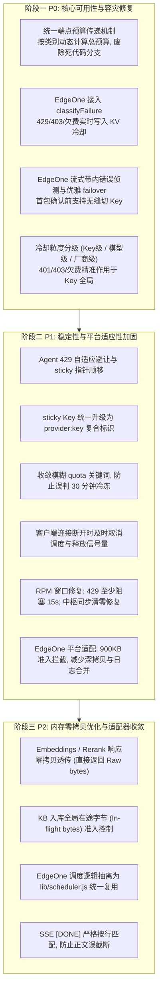

# ocrproxy 后端调度器与适配器审查复核与重构技术路线 (v1.0)

> 基线：`4402b1e` + UI 统一重构提交。本文档对后端审查报告中指出的 P0、P1、P2 以及三个专项补充（EdgeOne 硬限制、RPM 机制、KB 内存）进行源码级复核与架构设计。

---

## 一、 审查核心问题复核结论

经过对 `vm-app`（`scheduler.py`、`proxy_routes.py`、`upstream.py`）与 `agent-edgeone`（`completions.js`、`messages.js`、`cooldowns.js`、`config.js`）的逐项审查，**报告指出的隐患 100% 真实存在**：

### 1. P0 阻断性可用性问题
- **P0-1 KB/OCR 默认配置下几乎无 failover**：
  - `proxy_routes.py` 传入计算好的 `schedule_total_budget`，但 `scheduler.py:1350` 优先读取 `config["request_total_budget_sec"]`（历史默认 60s）。
  - OCR 单次超时 60s，首个候选超时后总预算立即耗尽，导致后续候选根本没有执行机会。
- **P0-2 EdgeOne 冷却与熔断完全脱靶**：
  - `lib/cooldowns.js` 内的 `classifyFailure()` 仅声明导出，在 `completions.js` / `messages.js` 中从未被调用；
  - 429、403、欠费错误**不会触发冷却**，只按 5xx 累计；401/403 甚至不计数，导致故障 Key 每个请求都必撞一遍。
- **P0-3 EdgeOne 流式 1.5s 快速超时剥夺 failover 且漏判带内错误**：
  - `completions.js` 1.5 秒后未收到首字节就草率提交 HTTP 200，后续上游报错或断流无法再切换 Key；
  - 首字节未做带内错误（`data: {"error": ...}`）判定。
- **P0-4 VM 首字节静默导致前置 CDN 524 风险**：
  - 调度器在首包确认前完全静默，长思考模型等待数十秒可能触发前置网关（如 Cloudflare 100s）超时切断。
- **P0-5 冷却粒度错位（Key 级故障按模型冷却）**：
  - `candidate_id` 包含 `:model`，导致 401/403/欠费等属于整个 Key 凭据的问题只冷却了当前模型，换个模型重复踩雷。

### 2. 专项补充核心风险
- **补充一（EdgeOne 平台硬约束）**：
  - 腾讯云 EdgeOne 边缘函数有严格的 1MB Body 限制、200ms CPU 时间限制与 20 次 console 调用上限。
  - 当前 EdgeOne 端每次 attempt 都进行全量 `JSON.parse(JSON.stringify(body))` 深拷贝，长上下文下极易打满 CPU 时间片或耗尽 128MB 内存。
- **补充二（RPM 机制缺陷）**：
  - `_rpm_mark_exhausted` 用最老时间戳 `w[0]` 填充，如果最老记录是 59 秒前，阻塞期仅 1 秒，随后暴跌再次撞 429。
  - 懒加载 Provider 丢失 `rpm_per_key` 属性；中枢同步无法清除已置 0 的 RPM。
- **补充三（KB 大并发内存雪崩）**：
  - Embeddings 与 Rerank 路由将上游数十兆向量响应反序列化为海量 Python 浮点对象（几百万个小对象），再序列化输出，小对象塞爆 pymalloc 且不触发 mmap 归还；
  - KB chat/embedding/rerank 在读入 body 前没有全局在途字节准入，高并发入库下易发生 RSS 暴涨。

---

## 二、 分阶段实施重构计划 (P0 → P1 → P2)



---

## 三、 核心技术方案设计

### 1. 预算计算解耦（P0-1）
- `proxy_routes.py` 不再向 `req_config` 注入易引起歧义的 `schedule_total_budget`；
- 改为按类别直接向调度器传递 `request_budget_sec`：
  $$\text{budget} = \text{clamp}(\text{single\_timeout} \times \min(\text{max\_retries}, \text{num\_cands}) + 5.0, \text{min\_val}, \text{global\_cap})$$
- 彻底解决 OCR/KB 单次 60s 耗尽导致第二个候选无法尝试的问题。

### 2. 冷却分级引擎（P0-5）
- 将故障失效拆分为三个独立维度：
  1. `key_level`（`provider:key`）：401（Key 无效）、403（欠费/封号）、402（无配额）。影响该 Key 下绑定的所有模型。
  2. `model_level`（`provider:key:model`）：404（模型不存在）、410（模型下线）、422（参数不可用）。仅隔离该具体模型映射。
  3. `provider_level`（`provider`）：502/503/504 上游网关宕机。短时间避让该厂商所有请求。

### 3. Embeddings / Rerank 零拷贝（M3）
- `ScheduleResult` 提供 `raw_content: bytes`；
- 对于无需 adapter rules 改写的向量/重排请求，直接返回：
  ```python
  return Response(content=sr.raw_content, media_type="application/json", headers=headers)
  ```
- 避免几百万个 Python float 小对象膨胀，彻底消除 pymalloc 内存碎片！
